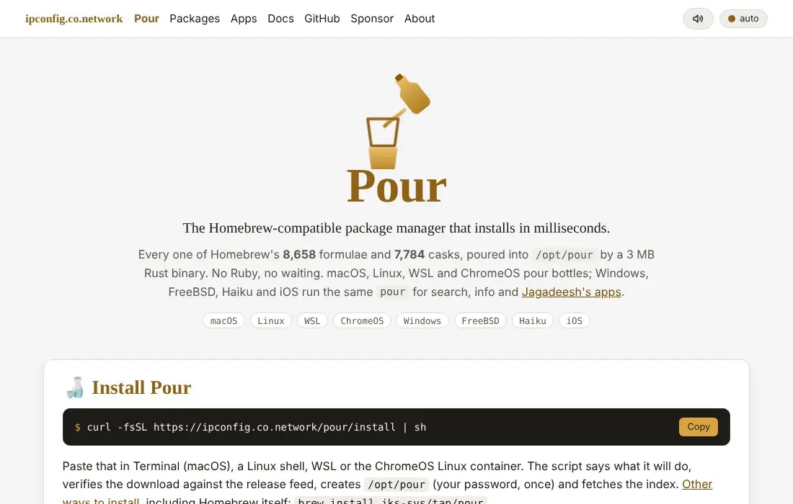
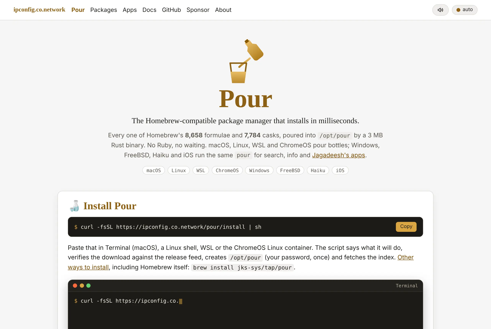
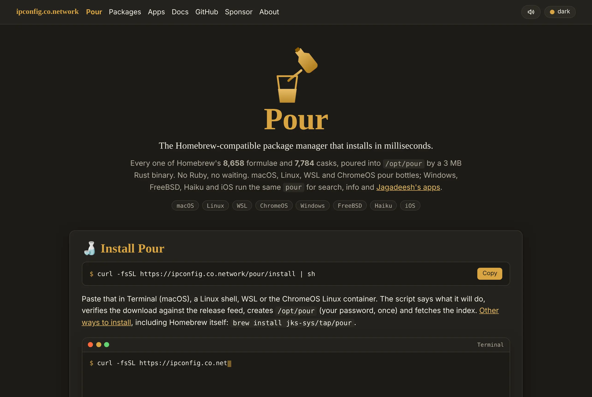
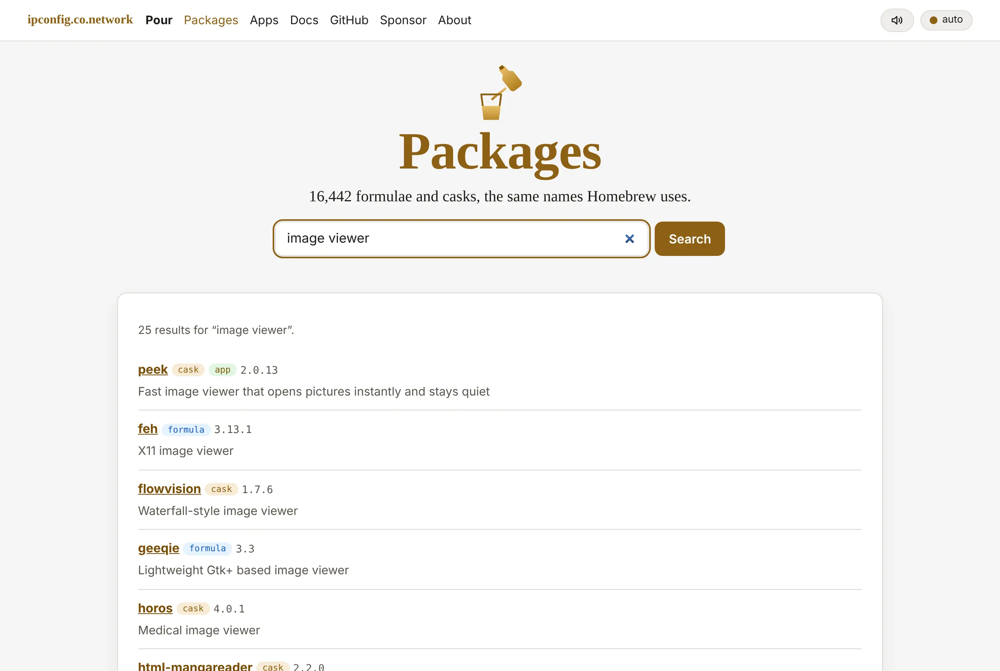
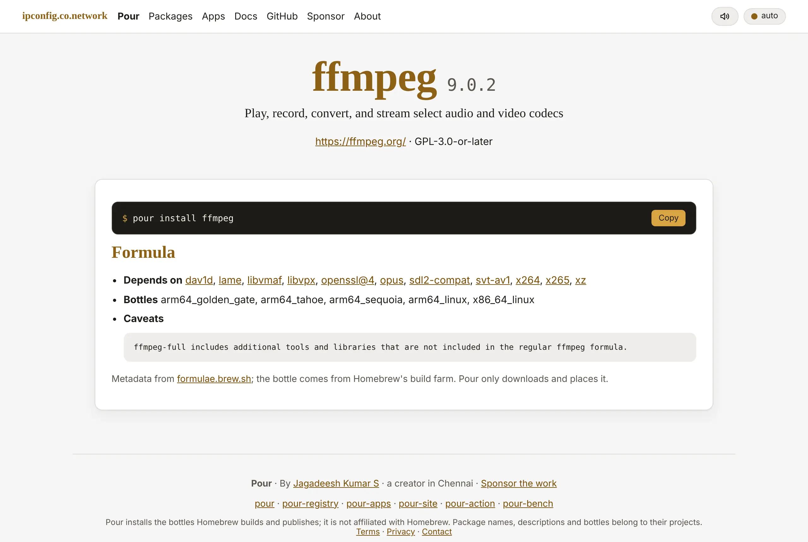

<p align="center">
  <picture>
    <source media="(prefers-color-scheme: dark)" srcset="docs/pour-dark.svg">
    
  </picture>
</p>

<h1 align="center">pour-site</h1>

<p align="center"><strong>The Pour website, mirror and release feed — <a href="https://ipconfig.co.network/pour">ipconfig.co.network/pour</a>.</strong><br>
One Cloudflare Worker on routes <code>ipconfig.co.network/pour*</code>, ahead of the main site's Worker, so nothing else changes.</p>


> ⭐ **If Pour saves you time, star this repository** — stars are how other people find it.

## See it move



[▶ Watch with sound (MP4)](docs/demo-site.mp4)

<table>
<tr>
<td><br><sub>Home — the install line, a typed terminal demo, why it is fast, live package counts.</sub></td>
<td><br><sub>The same page in the dark theme; the three-state theme control and the sound toggle are the site's own.</sub></td>
</tr>
<tr>
<td><br><sub>`/pour/search` — 16,000 formulae and casks plus the apps, ranked like `pour search`.</sub></td>
<td><br><sub>`/pour/p/ffmpeg` — a page per package from Homebrew's API, and per app from pour-apps.</sub></td>
</tr>
</table>

## Routes

| Path | What |
|---|---|
| `/pour` | home — install, demo, why, packages, apps, everywhere, sponsor |
| `/pour/install` | the installer (`curl … \| sh`), from R2 or GitHub |
| `/pour/releases/latest.json` | release feed with per-file SHA-256 — `pour self-update` and the installer read it |
| `/pour/dl/<asset>` · `/pour/dl/v0.1.0/<asset>` | binary mirror, newest or pinned to a version (falls back to GitHub Releases); pinned paths never change |
| `/pour/registry/index.pour.gz` · `index.json` · `search.json` · `changes.json` | the registry, with ETags |
| `/pour/apps/index.json` | the pour-apps registry |
| `/pour/search?q=` · `/pour/api/search?q=` | package search, HTML and JSON |
| `/pour/p/<name>` | package or app page |
| `/pour/apps` · `/pour/docs` | the apps, the docs |
| `/pour/api/stats` · `/pour/sitemap.xml` · `/pour/robots.txt` | counts, sitemap |

Everything under `public/pour/` (styles, script, logo, Open Graph image) is served as static assets.

## Run and deploy

```sh
npm install
npm run dev        # wrangler dev --local on http://127.0.0.1:8787/pour
npm run deploy     # wrangler deploy (needs CLOUDFLARE_API_TOKEN + CLOUDFLARE_ACCOUNT_ID)
```

`wrangler.toml` binds the `pour-registry` R2 bucket as `REGISTRY` and declares the two routes. Seed the local R2 for development: `npx wrangler r2 object put pour-registry/search.json --file ../pour-registry/dist/search.json --local`.

The site is deployed by `pour/update.sh` (step `site`) and by hand with `npm run deploy`. Every Cloudflare call in those scripts is retried on 5xx.

## Design notes

- The pages wear the live site's own header, footer, stylesheet and scripts (fetched from `/about`, cached 10 minutes), so the background (graph paper and the living node backdrop), the nav with its one **Sign in** button, the hero aurora, the `.prompt` command boxes and the theme/sound buttons are exactly the site's. `public/pour/style.css` only adds the Pour bits; its fallback tokens apply only when the site cannot be reached (`data-shell="fallback"`).
- No Homebrew formula or tap: Pour installs itself (`curl -fsSL https://ipconfig.co.network/pour/install | sh`) and every app after that (`pour install <app>`).
- Sounds are synthesised with Web Audio (clicks, a glug when the demo pours, a chime on ✓) and off with the site-wide toggle; motion respects `prefers-reduced-motion`.
- Server-rendered HTML with JSON-LD, Open Graph, a sitemap and 16 px gutters on phones; nothing to build.

<!-- licence -->
## Licence

Copyright © 2026 **Jagadeesh Kumar S**. All rights reserved. Source-available under the [Pour licence](https://github.com/JKS-sys/pour-13-Oct-2026/blob/main/LICENSE).
<!-- /licence -->

---

> **If Pour helps you, please ⭐ star this repository — it helps other people find it.**
